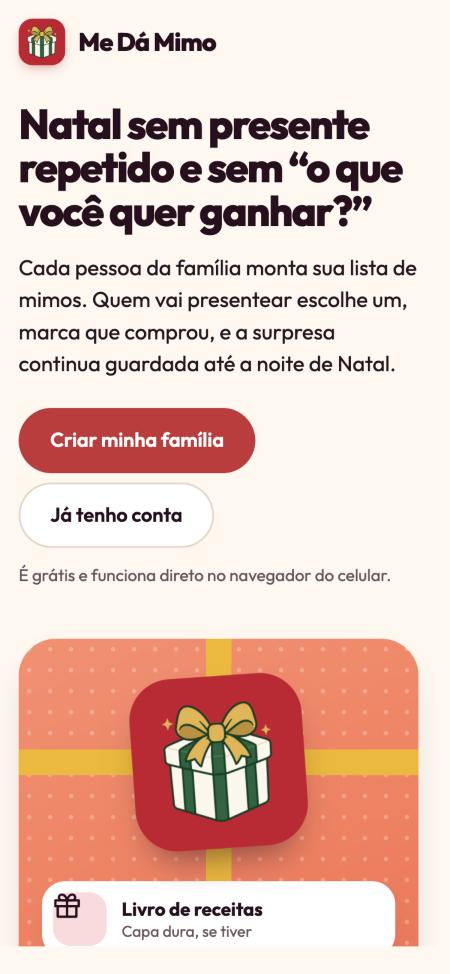
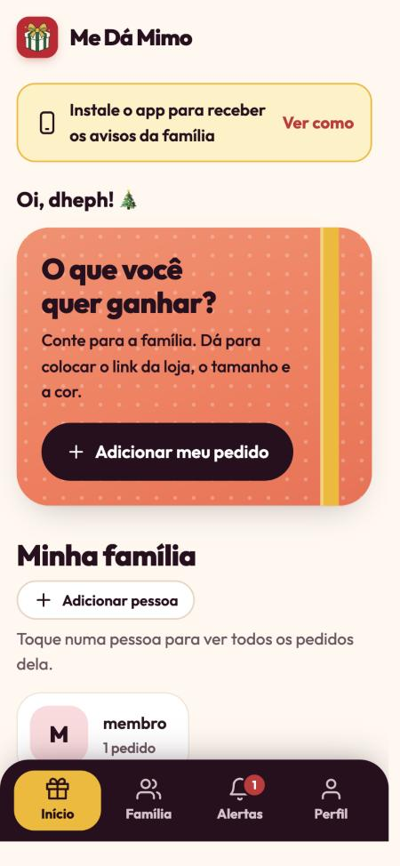
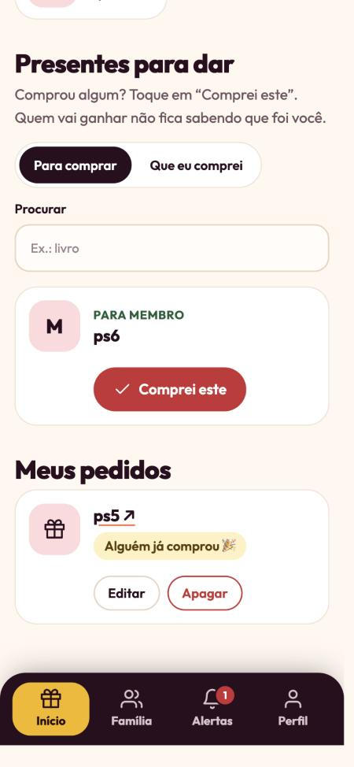
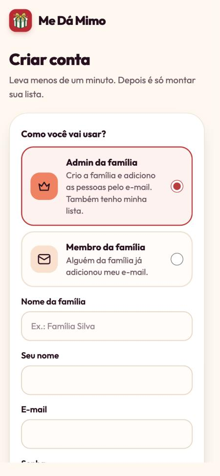
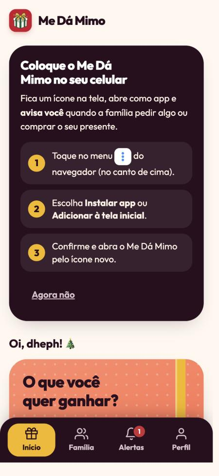

<p align="center">
  
</p>

<h1 align="center">Me Dá Mimo</h1>

<p align="center">
  Lista de presentes de Natal em família: sem presente repetido e sem estragar a surpresa.<br>
  <a href="https://dheph.github.io/me-da-mimo/"><strong>Abrir o app →</strong></a>
</p>

<p align="center">
  
  
  
</p>

## Como funciona

1. **Quem organiza cria a família** (em "Criar conta", escolha *Admin da família*) e logo em seguida o
   **primeiro evento**, como o *Natal 2026*. O app guia esse passo.
2. **O admin cria um usuário para cada pessoa** (ex.: `renan.lag`) e toca em **Enviar convite**. A
   mensagem vai com o link, o usuário e o **código da família**, pronta para o WhatsApp.
3. **No primeiro acesso, a pessoa usa usuário + código e cria a própria senha.** Um tour rápido mostra
   onde fica cada coisa.
4. **Cada um faz os seus pedidos no evento.** Toque em **Adicionar meu pedido**: link da loja, tamanho,
   cor. A família recebe um aviso.
5. **Comprou? Marque "Comprei este".** O presente sai da lista dos outros, para ninguém comprar
   repetido. **Quem vai ganhar não fica sabendo de nada**: nem que foi comprado, nem por quem.

**Várias famílias e eventos:** entre em outra família digitando o código dela (aba Família). Cada
família pode ter vários eventos (Natal, amigo secreto, aniversário), cada um com a sua lista. O topo do
início mostra o evento atual e o botão **Trocar**.

**Esqueci a senha:** o admin toca em **Nova senha** ao lado da pessoa e manda o código. Ela abre
"Esqueci a senha", digita usuário + código e cria uma senha nova. Quem entra com e-mail de verdade
também pode pedir um link por e-mail.

Tudo fica numa tela só: o botão de pedir, a sua família, os **presentes para dar** (com busca, filtro
por pessoa e "que eu comprei") e os **seus pedidos**.

<p align="center">
  
  
</p>

## Admin e membros

| | Admin | Membro |
|---|:---:|:---:|
| Faz os próprios pedidos e compra presentes | ✅ | ✅ |
| Cria eventos e usuários, gera códigos e remove pessoas | ✅ | — |
| Sai da família | — | ✅ |

O admin também é membro: tem a própria lista e ganha presente como todo mundo. A mesma pessoa pode
ser admin de uma família e membro de outra.

## Instalar no celular

O Me Dá Mimo funciona no navegador, mas **instalado** ele vira um ícone na tela e manda os avisos. O
próprio app mostra o passo a passo certo para o seu aparelho e lembra você até instalar.

- **Android (Chrome):** toque em **Instalar agora** no app. Se o botão não aparecer, use o menu ⋮ →
  *Instalar app*.
- **iPhone (Safari):** toque em **Compartilhar** → **Adicionar à Tela de Início** → **Adicionar**.
  Depois abra pelo ícone novo. No iPhone os avisos só funcionam assim (iOS 16.4 ou mais novo).
- **Abriu pelo WhatsApp ou Instagram?** Toque nos três pontinhos e escolha *Abrir no navegador*.

Depois de instalado, o app pede para **ativar os avisos**: é assim que você fica sabendo dos pedidos
da família e das compras dos seus presentes.

## Para desenvolver

É um site estático, sem etapa de build: HTML, CSS e JavaScript puros. Ele é publicado no GitHub Pages
e funciona como PWA (instalável e com notificações push).

```bash
python3 -m http.server 8000
```

Depois abra http://localhost:8000.

| Pasta / arquivo | O que tem |
|---|---|
| `index.html`, `app.js`, `style.css` | Telas e navegação |
| `install.js`, `push.js`, `sw.js`, `manifest.webmanifest` | Instalação, avisos e modo app |
| `icons/` | Logo e ícones do app |
| `supabase/` | Banco de dados e função de envio dos avisos |
| `docs/screenshots/` | Imagens deste README |

---

<p align="center">© 2026 Me Dá Mimo · Feito com carinho para o Natal em família</p>
